<div align="center">

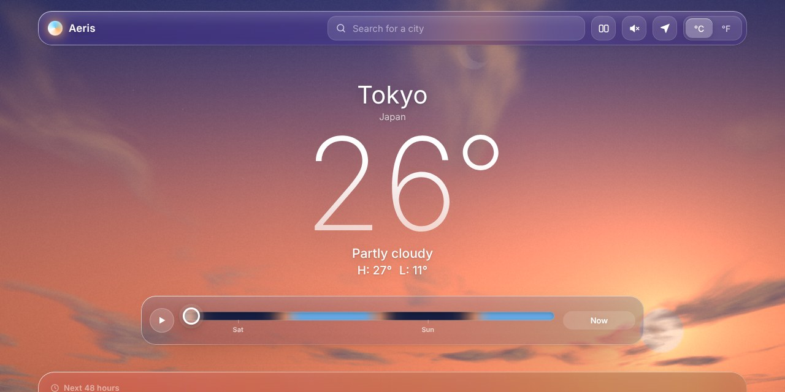

# Aeris

**Weather you can see.**<br>
A weather web app whose background is a live sky, drawn by your graphics card from the real forecast.

<a href="https://harshxt01.github.io/aeris/"></a>


</div>

<br>

<p align="center">
  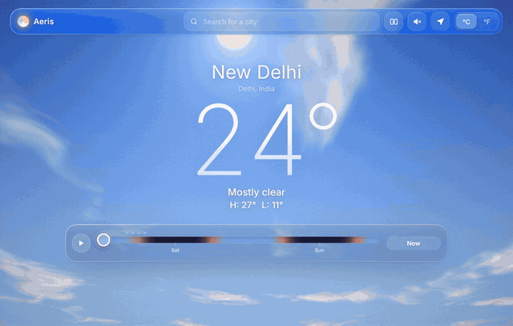
  <br>
  <sub>Drag the time ribbon and the sky follows the forecast: midday, a starry night, then a pink sunrise.</sub>
</p>

## Why I built it

Most weather apps show you numbers. Aeris shows you the sky those numbers describe. The sun rises and sets at the real times for your city. Cloud cover, rain, snow, fog and storms come straight from the forecast. When it rains, drops run down your screen and you can wipe the misted glass with your cursor.

It's my first portfolio project as a B.Tech CSE (AI/ML) student. I built it in plain HTML, CSS and JavaScript with no frameworks and no build step, so every line can be read and changed.

## One sky, every weather

<table>
  <tr>
    <td width="50%">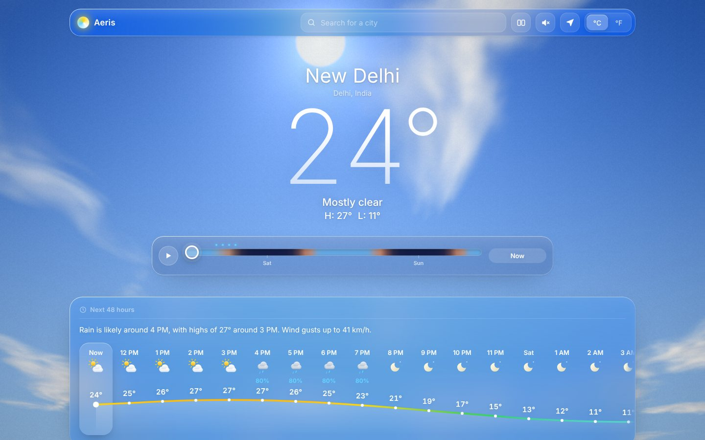<br><b>Clear day.</b> Sun position from today's sunrise and sunset, clouds from forecast cloud cover.</td>
    <td width="50%">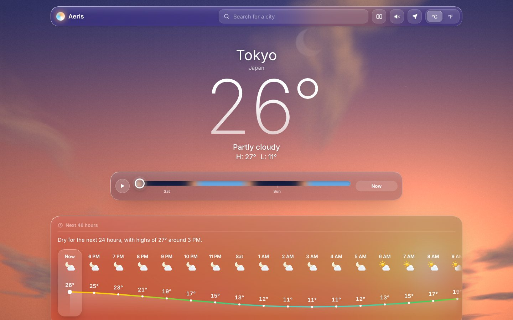<br><b>Golden hour.</b> Sunrise and sunset blend warm light into the sky and the clouds.</td>
  </tr>
  <tr>
    <td width="50%">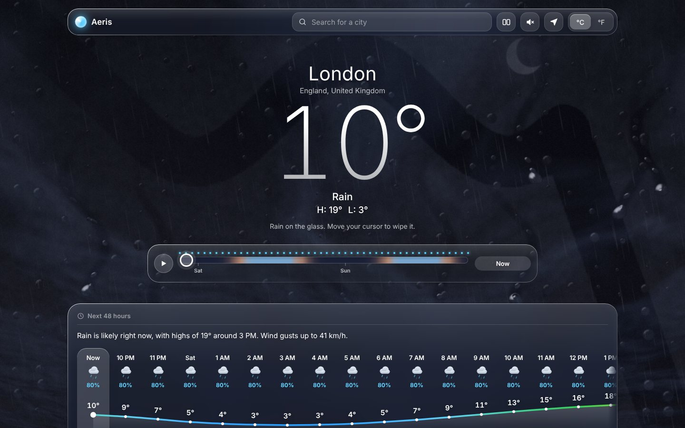<br><b>Rain on the glass.</b> Drops bend the light behind them. The dark trail is where the cursor wiped the mist away.</td>
    <td width="50%">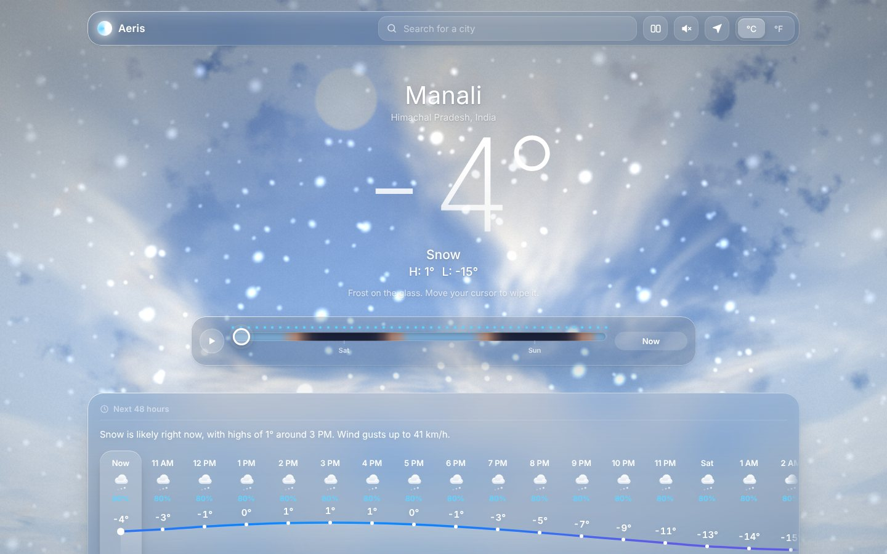<br><b>Snow and frost.</b> Three depths of snowfall, plus frost creeping in from the edges below freezing.</td>
  </tr>
</table>

## Features

### The sky
- **Live WebGL sky**, recalculated for every pixel 60 times a second: sky colour by sun height, sun with bloom, crescent moon, twinkling stars, and clouds on a 3D plane lit from the sun's side.
- **Rain on the glass.** Beads, running drops and wet trails that refract the sky. The glass mists over and **you can wipe it** with your cursor or finger. It slowly fogs up again.
- **Snow, fog, frost and thunderstorms**, with real lightning flashes.
- **48-hour time ribbon.** It shows the sky's colour for every hour, with dots where rain is likely. Drag it, press Play, or use the ← and → keys.

### A forecast that means something
| | |
|---|---|
| **Comfort score** | One number from 0 to 100 for how pleasant it feels, with an outfit tip |
| **Best time outside** | The best 2-hour window in the next 24 hours, with a bar for every hour |
| **Air quality and UV** | US AQI, PM2.5 and UV, colour-coded with plain-English advice |
| **Sun and golden hour** | A sun arc with sunrise, sunset, golden hours and daylight left |
| **Wind and pressure** | Animated gauges with gusts, direction and pressure trend |
| **Feels like, humidity, visibility, rain** | Each one explained in a sentence, not just a number |
| **Hourly and 7-day** | A temperature curve coloured by temperature, and Apple-style range bars |

### Compare two cities
Two live skies side by side, with local time, comfort, rain, wind, humidity, UV, air quality and sun times. A plain-English summary like *"London is 14° cooler than New Delhi, and it's raining there. Local time there is 5h 30m behind."* A 24-hour temperature chart shows both cities.

<p align="center">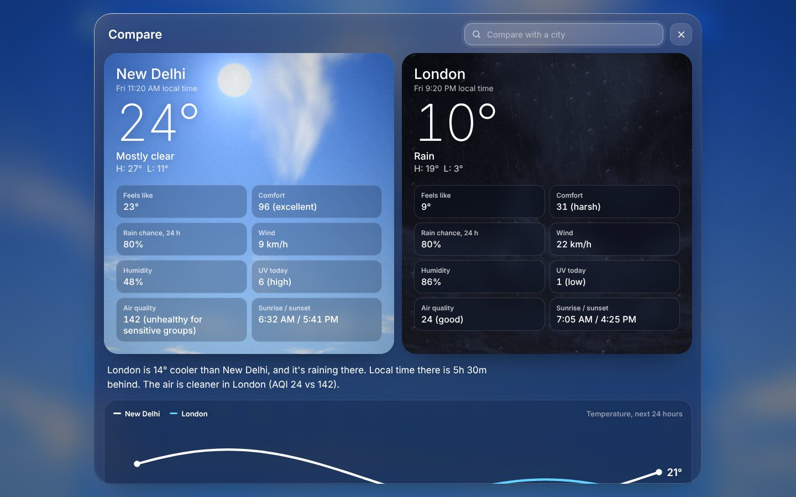</p>

### Sky sounds
Rain, drops tapping the glass, wind that follows the forecast, thunder a moment after each flash, crickets on warm nights and birds on fine days. **Every sound is generated in code** with the Web Audio API. There are no audio files.

### A real app
- **Installable.** Aeris is a PWA (Progressive Web App), so you can add it to your home screen and it opens full screen with its own icon.
- **Works offline.** A service worker saves the app and your latest forecasts. With no internet, Aeris shows the last saved forecast and tells you when it was saved.
- City search, your location, °C and °F, and Aeris remembers your last city.

<p align="center">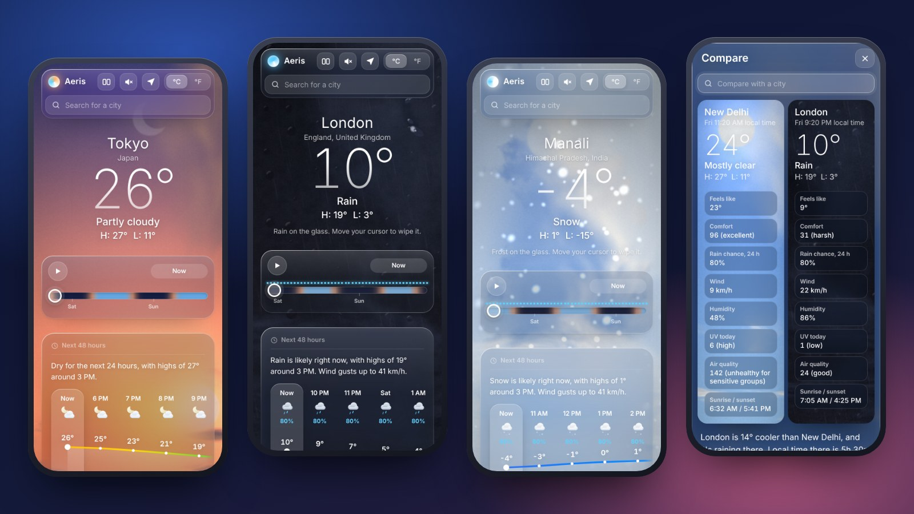</p>

<p align="center">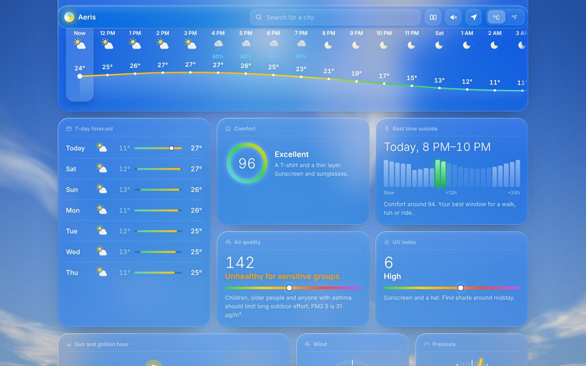 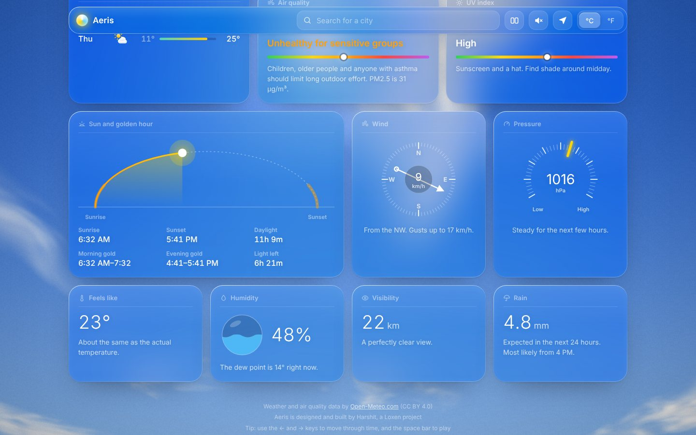</p>

## How it works

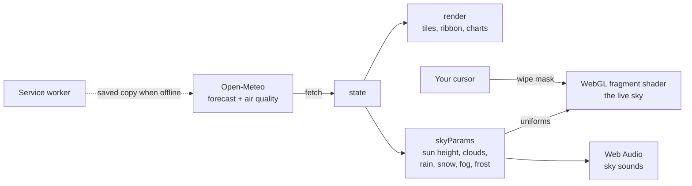

1. **Data.** Aeris asks [Open-Meteo](https://open-meteo.com/) for 7 days of hourly weather and current air quality. It's free and needs no API key.
2. **Sky settings.** For the hour you're looking at, `skyParams()` turns the forecast into a handful of numbers: how high the sun is, how cloudy it is, and how much rain, snow, fog and frost there is.
3. **The shader.** Those numbers go to a fragment shader, a small program the graphics card runs for every pixel. It paints the sky gradient, sun, moon, stars, noise-based clouds, rain, snow, the drops on the glass and the mist.
4. **Smooth changes.** The page eases between old and new values every frame, so dragging through time looks like a time-lapse instead of a jump.

<details>
<summary><b>How the comfort score works</b></summary>

<br>

It starts at 100 and loses points for anything unpleasant. You can find it in `index.html`, function `comfort()`.

```js
function comfort(feels, hum, wind, pop, uv) {
  let p = Math.min(60, Math.abs(feels - 22) * (feels < 22 ? 3 : 3.5)); // far from a pleasant 22°C
  if (hum > 70) p += Math.min(15, (hum - 70) * 0.5);                   // sticky air
  else if (hum < 25) p += Math.min(8, (25 - hum) * 0.3);              // very dry air
  if (wind > 15) p += Math.min(20, (wind - 15) * 0.8);                 // strong wind
  p += Math.min(20, pop * 0.2);                                         // chance of rain
  if (uv > 7) p += Math.min(10, (uv - 7) * 2.5);                        // harsh sun
  return clamp(Math.round(100 - p), 0, 100);
}
```

**Best time outside** scores each daytime hour (6 AM to 9 PM) in the next 24 hours with this formula and picks the best two hours in a row.

**Golden hour** is estimated as the hour after sunrise and the hour before sunset.

</details>

<details>
<summary><b>How the sun moves</b></summary>

<br>

Between sunrise and sunset, the fraction of the day that has passed (`f`, from 0 to 1) places the sun on an arc. Its height is `sin(π × f)`, so it's 0 at sunrise, highest at midday, and 0 again at sunset. At night the same idea runs below the horizon, and the moon travels across the sky instead.

</details>

<details>
<summary><b>How the drops on the glass work</b></summary>

<br>

The screen is split into an invisible grid. Each cell gets random numbers that decide whether it holds a drop, where, and how big. For each pixel inside a drop, the shader shifts where it samples the sky, like a tiny lens. That's the refraction. Running drops use tall columns and move down over time, leaving a clear trail and tiny beads behind them. Your wipes are drawn into a small black-and-white canvas that the shader reads to clear the mist.

</details>

## Controls

| Action | How |
|---|---|
| Move through time | Drag the ribbon, tap an hour, or press ← → |
| Play the next 48 hours | Play button or Space |
| Wipe the glass | Move your cursor over the sky, or drag a finger |
| Compare cities | The two-panel button in the top bar |
| Sky sounds | The speaker button |
| Install | The download button in the top bar (Chrome, Edge) or Share, then Add to Home Screen (iPhone) |

## Project structure

```
aeris/
├── index.html            the whole app: layout, styles, sky shader and logic
├── sw.js                 service worker: offline mode and caching
├── manifest.webmanifest  app name, colours and icons for installing
├── icons/                app icons (192, 512, maskable, Apple touch)
└── docs/                 screenshots and the demo GIF for this README
```

## Run it locally

```bash
git clone https://github.com/harshxt01/aeris.git
cd aeris
python3 -m http.server 8000
```

Open <http://localhost:8000>. You can also just double-click `index.html`. Everything works that way except installing and offline mode, which need a web address.

> **Updating the site?** Change `VERSION` in `sw.js` (for example, `aeris-v5` to `aeris-v6`) whenever you change `index.html`, so visitors get the new version instead of the saved offline copy.

## Performance and accessibility

- The sky is drawn slightly below screen resolution, because it's soft, so it stays smooth on laptops.
- It respects **Reduce motion**: animations slow down and the sky changes instantly instead of gliding.
- If WebGL isn't available, Aeris falls back to a gradient that still follows the weather.
- Keyboard controls, visible focus outlines and labelled buttons throughout.

## Ideas for next

- [ ] Weather postcards: save the current sky as a shareable image
- [ ] Saved places: swipe between your favourite cities
- [ ] Rain radar map
- [ ] Weather alerts banner for storms and poor air quality
- [ ] Rebuild with Next.js and TypeScript

## License

Released under the [MIT License](LICENSE). You're free to use, change and share the code, as long as the copyright notice stays with it.

## Credits

- Weather and air quality data by [Open-Meteo.com](https://open-meteo.com/), licensed [CC BY 4.0](https://creativecommons.org/licenses/by/4.0/)
- Reverse geocoding for "use my location" by [BigDataCloud](https://www.bigdatacloud.com/)
- Colour palette inspired by Apple Weather

<sub>Screenshots in this README use sample forecast data so every kind of weather can be shown.</sub>

<div align="center">
<br>

Designed and built by **Harshit** ([@harshxt01](https://github.com/harshxt01)), a **Loxen** project. Built with intent.

</div>
